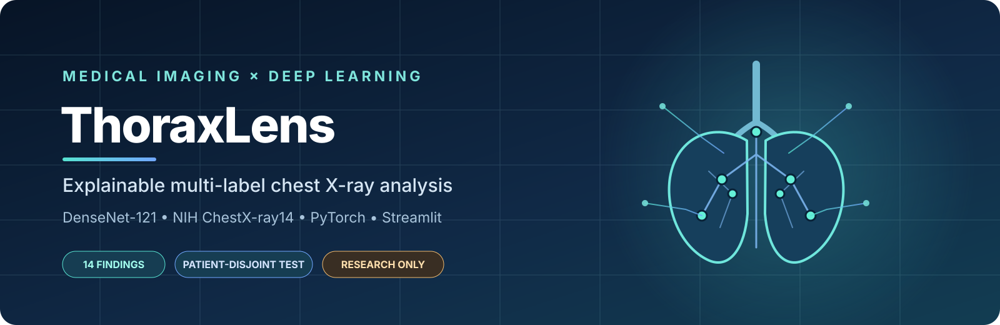
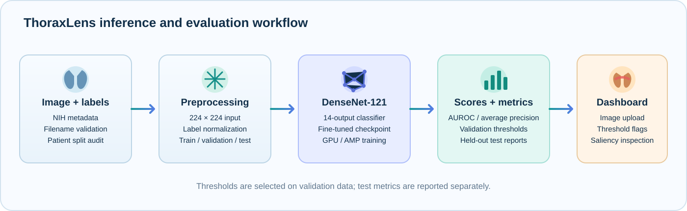
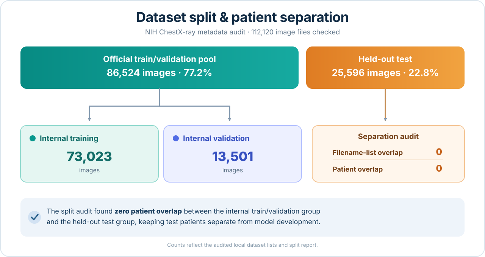
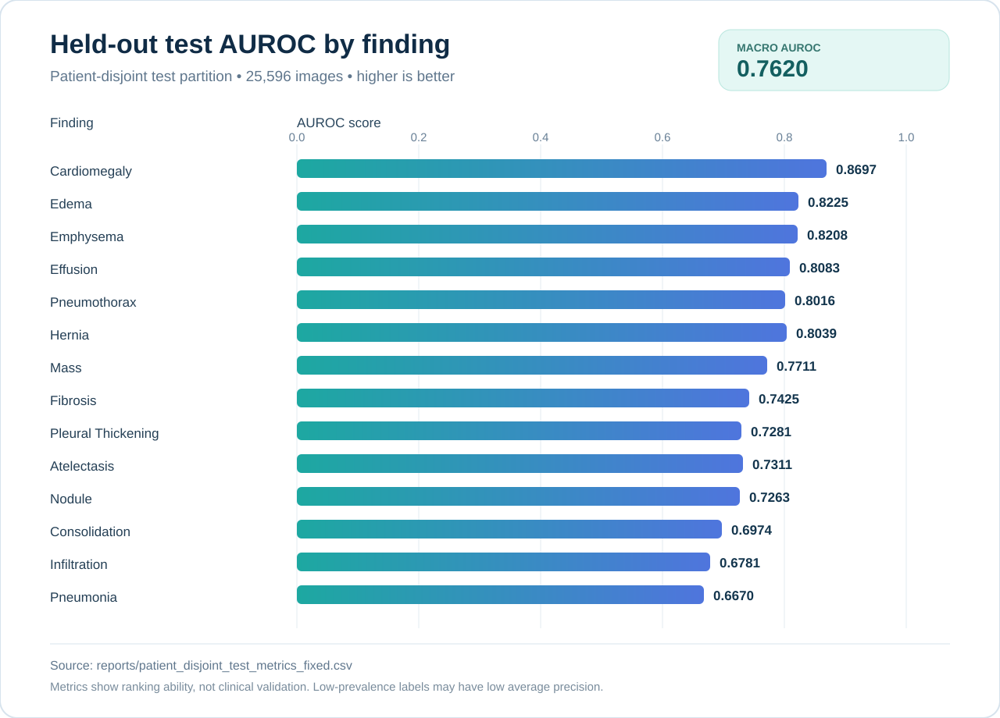
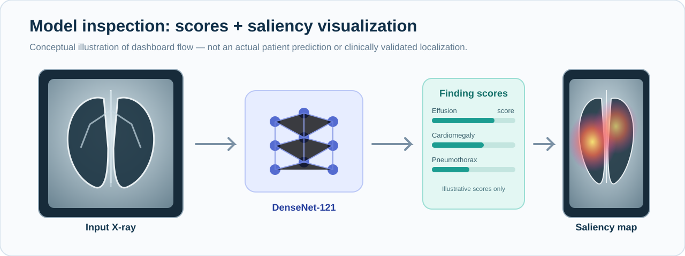

**DenseNet-121 · NIH ChestX-ray14 · PyTorch · Streamlit · Grad-CAM / Saliency Inspection**

*An end-to-end research implementation for 14-label chest radiograph classification, patient-aware evaluation, validation-selected thresholds, and visual model inspection.*

> [!WARNING]
> **Research and education only — not a medical device.** ThoraxLens has not been clinically validated. Its scores, threshold flags, and saliency maps are not diagnoses and must not be used to make clinical decisions.

## Table of contents

- [Project overview](#project-overview)
- [Highlights](#highlights)
- [Workflow](#workflow)
- [Dataset and split audit](#dataset-and-split-audit)
- [DenseNet-121 architecture](#densenet-121-architecture)
- [Training setup](#training-setup)
- [Results](#results)
- [Threshold calibration](#threshold-calibration)
- [Dashboard and explainability](#dashboard-and-explainability)
- [Installation and running](#installation-and-running)
- [Repository map](#repository-map)
- [Limitations](#limitations)
- [Acknowledgements and references](#acknowledgements-and-references)

---

## Project overview

ThoraxLens predicts scores for **14 findings** from a frontal chest X-ray. This is a **multi-label classification** task: more than one finding can receive a score for the same image.

The project is inspired by [Laurent Veyssier's Chest-X-Ray-Medical-Diagnosis-with-Deep-Learning repository](https://github.com/LaurentVeyssier/Chest-X-Ray-Medical-Diagnosis-with-Deep-Learning), which explains DenseNet-121, class-imbalance handling, ROC/AUC evaluation, and Grad-CAM. ThoraxLens is a separate PyTorch implementation with patient-split auditing, saved per-label evaluation reports, validation-derived decision thresholds, and a Streamlit research dashboard.

**This is not an exact reproduction** of the upstream TensorFlow/Keras notebook, training protocol, or its bundled model weights. Results below are from the ThoraxLens experiments described in this project.

## Highlights

- DenseNet-121 multi-label classifier with 14 output scores.
- Dataset filename, list membership, and patient split auditing.
- Corrected label alias handling for the NIH metadata label <code>Pleural_Thickening</code>.
- Held-out test evaluation using AUROC and average precision.
- Per-label decision thresholds selected on validation data, then kept fixed for test evaluation.
- Streamlit dashboard for X-ray upload, score inspection, threshold flags, and saliency visualization.
- CSV/JSON experiment outputs and documentation of the evaluation protocol.

## Workflow

The workflow separates training, validation-based threshold selection, and held-out test evaluation. Thresholds are selected with validation data; they are not tuned against the test set.

## Dataset and split audit

ThoraxLens uses the NIH ChestX-ray dataset. Obtain it from the [NIH ChestX-ray portal](https://nihcc.app.box.com/v/Chestxray-NIHCC) and follow its access terms. Dataset images and the original archives are **not included** in this repository.

The local dataset audit recorded:

| Audit item | Result |
|---|---:|
| Extracted PNG images | 112,120 |
| Rows in <code>Data_Entry_2017_v2020.csv</code> | 112,120 |
| Image/metadata filename mismatches | 0 |
| Official train/validation list | 86,524 images |
| Official test list | 25,596 images |
| Filename overlap between official lists | 0 |
| Patient overlap reported by split audit | 0 |
| Internal training partition | 73,023 images |
| Internal validation partition | 13,501 images |
| Held-out test images evaluated | 25,596 |

The corrected label normalizer maps <code>Pleural_Thickening</code> to **Pleural Thickening**. The corrected held-out test report contains 1,143 positive test cases for this finding.

Expected local dataset layout:

<pre><code>data/
└── nih/
    ├── Data_Entry_2017_v2020.csv
    ├── train_val_list.txt
    ├── test_list.txt
    └── images/                 # extracted PNG images</code></pre>

See <code>data/DATASET_DOWNLOAD.md</code> for dataset setup notes. Local paths can differ from machine to machine.

## DenseNet-121 architecture

DenseNet is built around densely connected blocks: each layer receives feature maps from earlier layers and passes its output to later layers. This promotes feature reuse and creates short paths for gradient propagation. ThoraxLens uses a DenseNet-121 backbone with a **14-output classification head**.

### Architecture overview

### Dense connections

The animation below comes from the upstream reference project and illustrates its explanation of dense connections. It is **reference material, not a ThoraxLens training visualization**.

### Dense blocks, dense layers, and transition layers

<table>
<tr>
<td width="50%" valign="top">

**Dense block**

</td>
<td width="50%" valign="top">

**Dense layer**

</td>
</tr>
<tr>
<td width="50%" valign="top">

**Feature-map growth**

</td>
<td width="50%" valign="top">

**Transition layer / concatenation**

</td>
</tr>
</table>

These architecture figures are embedded from the original repository and remain hosted by its author. See the [reference README's DenseNet section](https://github.com/LaurentVeyssier/Chest-X-Ray-Medical-Diagnosis-with-Deep-Learning#densenet-architecture) for their detailed explanation. They are not original ThoraxLens figures.

## Training setup

The final corrected fine-tuning run used:

| Setting | Value |
|---|---|
| Architecture | DenseNet-121, 14 output labels |
| Image size | 224 × 224 |
| Batch size | 2 |
| Epochs completed | 2 |
| Mixed precision | Enabled (AMP) |
| GPU | NVIDIA GeForce RTX 2050, 4 GB VRAM |
| PyTorch / Torchvision | 2.14.1+cu130 / 0.29.1+cu130 |
| Initialization | Earlier project checkpoint <code>densenet121_xray_best.pth</code> |
| Final best checkpoint (local) | <code>models/densenet121_xray_label_fixed_best.pth</code> |

The corrected run fine-tuned from an earlier project checkpoint; it was **not trained from scratch**.

| Epoch | Training loss | Validation loss | Validation macro AUROC | Validation macro AP |
|---:|---:|---:|---:|---:|
| 1 | 0.6699 | 0.7687 | 0.7742 | 0.1444 |
| 2 | 0.6388 | 0.6837 | 0.7838 | 0.1618 |

## Results

Evaluation used **25,596 held-out test images**. AUROC and average precision measure ranking quality; they do not by themselves establish clinical utility or guarantee performance at a decision threshold.

| Test metric | Result |
|---|---:|
| Macro AUROC | **0.7620** |
| Macro average precision | **0.2002** |
| Macro precision at validation-selected thresholds | 0.1969 |
| Macro recall at validation-selected thresholds | 0.4352 |
| Macro F1 at validation-selected thresholds | 0.2613 |

### AUROC by finding

### Per-finding ranking metrics

| Finding | Positive test cases | AUROC | Average precision |
|---|---:|---:|---:|
| Atelectasis | 3,279 | 0.7311 | 0.2821 |
| Cardiomegaly | 1,069 | 0.8697 | 0.3015 |
| Consolidation | 1,815 | 0.6974 | 0.1187 |
| Edema | 925 | 0.8225 | 0.1262 |
| Effusion | 4,658 | 0.8083 | 0.4671 |
| Emphysema | 1,093 | 0.8208 | 0.1927 |
| Fibrosis | 435 | 0.7425 | 0.0435 |
| Hernia | 86 | 0.8039 | 0.0142 |
| Infiltration | 6,112 | 0.6781 | 0.3739 |
| Mass | 1,748 | 0.7711 | 0.2608 |
| Nodule | 1,623 | 0.7263 | 0.1916 |
| Pleural Thickening | 1,143 | 0.7281 | 0.0988 |
| Pneumonia | 555 | 0.6670 | 0.0385 |
| Pneumothorax | 2,665 | 0.8016 | 0.2938 |

## Threshold calibration

Thresholds for each label were chosen by maximizing F1 on the **validation split**, then kept fixed for held-out test evaluation. The test set was not used to choose thresholds. These are experiment-specific operating points, not medical cutoffs.

| Finding | Validation threshold | Test precision | Test recall | Test F1 |
|---|---:|---:|---:|---:|
| Atelectasis | 0.6841 | 0.2434 | 0.5657 | 0.3404 |
| Cardiomegaly | 0.9332 | 0.3246 | 0.4041 | 0.3600 |
| Consolidation | 0.7917 | 0.1292 | 0.4871 | 0.2043 |
| Edema | 0.8822 | 0.1183 | 0.6011 | 0.1978 |
| Effusion | 0.7765 | 0.3804 | 0.7306 | 0.5003 |
| Emphysema | 0.8836 | 0.1990 | 0.4163 | 0.2692 |
| Fibrosis | 0.7341 | 0.0575 | 0.2069 | 0.0900 |
| Hernia | 0.9172 | 0.0284 | 0.0581 | 0.0382 |
| Infiltration | 0.5332 | 0.3206 | 0.7546 | 0.4500 |
| Mass | 0.9218 | 0.3060 | 0.3793 | 0.3387 |
| Nodule | 0.8401 | 0.1874 | 0.3845 | 0.2520 |
| Pleural Thickening | 0.7415 | 0.1139 | 0.4094 | 0.1782 |
| Pneumonia | 0.8209 | 0.0441 | 0.2414 | 0.0746 |
| Pneumothorax | 0.8554 | 0.3042 | 0.4533 | 0.3641 |

Detailed experiment outputs live in <code>reports/</code>, including corrected per-finding test metrics, thresholded test metrics, training history, and validation threshold JSON/CSV files. The full results narrative is in [docs/FINAL_RESULTS.md](docs/FINAL_RESULTS.md).

## Dashboard and explainability

The dashboard supports X-ray image upload, per-finding model scores, comparisons against validation-derived thresholds, and a saliency heatmap for exploratory model inspection.

> **About this figure:** this is a conceptual illustration of the workflow. Its example scores and heatmap are not a real ThoraxLens prediction or a clinical localization result. Actual predictions can disagree with report-derived labels.

### Run the dashboard

From the project root, after installing dependencies and supplying a compatible checkpoint plus its matching threshold JSON:

<pre><code>python -m streamlit run app.py</code></pre>

Then open [http://localhost:8501](http://localhost:8501) in your browser.

The displayed scores are raw model outputs and should not automatically be interpreted as calibrated probabilities. A threshold flag is not a diagnosis. A saliency map does not prove that the model found a clinically valid feature or correctly localized a finding.

## Installation and environment

The documented experiments used Python 3.11, PyTorch/Torchvision, pandas, NumPy, scikit-learn, Pillow, Matplotlib, and Streamlit.

<pre><code>py -3.11 -m venv .venv
.\.venv\Scripts\Activate.ps1
python -m pip install --upgrade pip
python -m pip install -r requirements.txt</code></pre>

For GPU acceleration, install a CUDA-enabled PyTorch/Torchvision build compatible with your setup using the [official PyTorch installation selector](https://pytorch.org/get-started/locally/).

## Repository map

<pre><code>ThoraxLens/
├── README.md
├── app.py
├── audit_splits.py
├── validate_dataset.py
├── requirements.txt
├── CITATION.cff
├── MODEL_CARD.md
├── NOTICE.md
├── assets/                         # README visuals and diagrams
├── data/
│   └── DATASET_DOWNLOAD.md         # instructions only; dataset is not committed
├── docs/
│   ├── ARCHITECTURE.md
│   ├── EVALUATION_PROTOCOL.md
│   ├── FINAL_RESULTS.md
│   └── PROJECT_OVERVIEW.md
├── reports/                        # tracked experiment CSV/JSON outputs
├── src/                            # data, model, training, evaluation, inference
└── tests/                          # automated unit tests</code></pre>

For project background, see [Project overview](docs/PROJECT_OVERVIEW.md). For the full metric tables, see [Final results](docs/FINAL_RESULTS.md). Architecture and evaluation details are in [docs/ARCHITECTURE.md](docs/ARCHITECTURE.md) and [docs/EVALUATION_PROTOCOL.md](docs/EVALUATION_PROTOCOL.md). Model limitations and attribution are documented in [MODEL_CARD.md](MODEL_CARD.md) and [NOTICE.md](NOTICE.md).

Trained checkpoints and the NIH images are intentionally excluded from GitHub because of their size and the dataset's access terms. Place the local dataset under <code>data/nih/</code> as described in <code>data/DATASET_DOWNLOAD.md</code>.

## Limitations

- NIH ChestX-ray labels are report-derived and can be noisy or incomplete.
- Class prevalence is highly imbalanced; average precision varies substantially by finding.
- The model has not undergone external clinical validation.
- Saliency maps are exploratory visualizations, not verified lesion localization or causal explanations.
- This model is **not for diagnosis, triage, treatment, or other clinical decisions**.
- The reported two-epoch fine-tuning run is a research baseline, not evidence of clinical readiness.

## Acknowledgements and references

- **Reference project:** Laurent Veyssier, [Chest-X-Ray-Medical-Diagnosis-with-Deep-Learning](https://github.com/LaurentVeyssier/Chest-X-Ray-Medical-Diagnosis-with-Deep-Learning). The linked architecture diagrams and dense-connection animation are hosted by that original repository and are used here as explicitly attributed reference illustrations; they are not ThoraxLens outputs.
- **Dataset:** NIH Clinical Center, [Chest X-ray dataset portal](https://nihcc.app.box.com/v/Chestxray-NIHCC).
- **Architecture paper:** Huang et al., [Densely Connected Convolutional Networks](https://arxiv.org/abs/1608.06993).

---

**ThoraxLens — an explainable-AI research prototype for chest X-ray analysis.**

