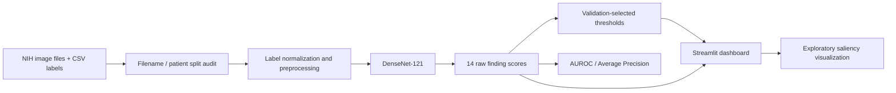

# ThoraxLens Architecture

## Overview

The project is organized around dataset validation, model definition, training, evaluation, threshold calibration, inference, and a Streamlit dashboard.

## Modules

| Path | Responsibility |
|---|---|
| `app.py` | Streamlit dashboard and user-facing inference workflow |
| `audit_splits.py` | Audit image lists and patient split overlap |
| `validate_dataset.py` | Validate dataset inventory and metadata consistency |
| `src/data.py` | Image/label loading and dataset preparation |
| `src/labels.py` | Finding label normalization and aliases |
| `src/model.py` | DenseNet-121 model construction |
| `src/train.py` | Model fine-tuning and checkpoint writing |
| `src/evaluate.py` | Evaluation metrics and per-label results |
| `src/evaluate_thresholds.py` | Evaluation at saved per-label thresholds |
| `src/calibrate_thresholds.py` | Validation-based threshold calibration |
| `src/inference.py` | Prediction-time utilities |
| `tests/` | Data, label alias, model and training tests |
| `reports/` | CSV/JSON output from documented experiments |

## Output semantics

The model produces one score for each of the 14 findings. These scores should not be assumed to be calibrated clinical probabilities. A label threshold turns a score into an experimental binary flag; the flag is not a diagnosis.

## Interpretability

The dashboard's saliency view is provided for exploratory model inspection. Saliency does not prove that a finding is localized correctly or that the model uses a medically valid explanation.
